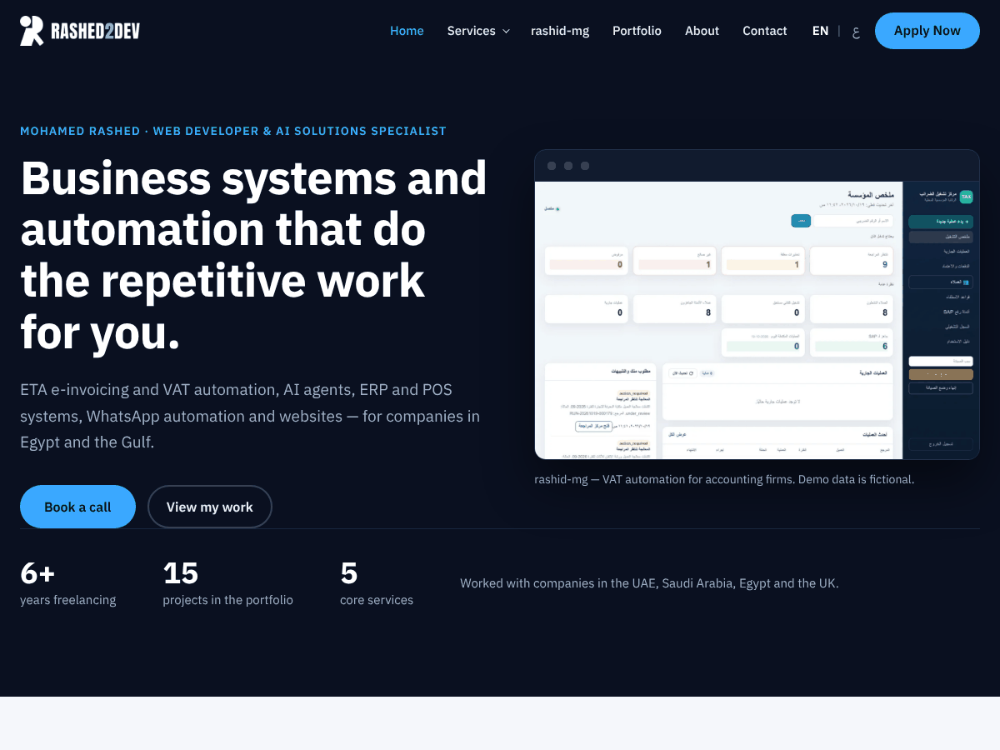

# Rashed — a bilingual (English / Arabic) WordPress theme

A free, open-source WordPress theme for freelancers and small agencies who need a fast
portfolio, service pages and a blog in **English and Arabic (right-to-left)**.
No page builder, no jQuery, no tracking.

> The theme folder and text domain are `rashid`; the name shown in the dashboard is **Rashed**.

## What you get
- English (left-to-right) and Arabic (right-to-left) layouts, built with logical CSS properties so both read naturally.
- Works with [Polylang](https://wordpress.org/plugins/polylang/) (free) for separate English and Arabic pages and posts.
- A **portfolio** post type with project pages, filters and a featured-projects block.
- A **blog**: listing, categories, article pages, "On this page" list, reading time, related articles and an author box.
- A **Search appearance** panel in the editor (search title and description per page), plus structured data (Person, WebSite, BlogPosting, breadcrumbs).
- Block-editor friendly: pages are plain core blocks, nothing locks you in.
- Performance by default: minified CSS printed inline, self-hosted fonts, no render-blocking requests, small logo `sizes`.
- Accessibility: visible keyboard focus, 44 px touch targets, contrast checked, skip link.
- A lead form shortcode (`[rashid_lead_form]`) for contact and quote requests.
- Customizer options for your name, role, profile links, call-to-action text and footer.

## Requirements
WordPress 6.4+ and PHP 8.1+. Polylang is optional but recommended for two languages.

## Install
1. Download this repository as a ZIP (**Code > Download ZIP**).
2. In WordPress: **Appearance > Themes > Add New > Upload Theme**, choose the ZIP, then **Activate**.
3. Set your logo in **Appearance > Customize > Site Identity** and your name, role and profile links in the theme options.

The compiled CSS and JavaScript are included, so no build step is needed to use the theme.

## For developers
- `src/` holds PHP classes (namespace `Rashid\`), one responsibility per file; `inc/` has small template helpers; templates stay free of logic. See [`docs/ARCHITECTURE.md`](docs/ARCHITECTURE.md).
- CSS lives in `assets/css/src/*.css` and is compiled into `assets/css/main.css` with `bin/build-assets.sh` (needs `bash` and `python3`). Run `bin/check.sh` before sending a change: it lints PHP and confirms the built files match the sources.
- Never edit `assets/css/main.css` or `assets/js/main.js` by hand.
- Translations: `languages/rashid.pot` is the template; Arabic is included (`ar.po`, compiled with `bin/compile-mo.py`).

## Contributing
Issues and pull requests are welcome. Please keep changes small, run `bin/check.sh`, and
include a note on how you tested (languages, screen widths, keyboard).

## Licence
- Theme code: **GPL-2.0-or-later** (see [`LICENSE`](LICENSE)).
- Fonts: IBM Plex Sans and IBM Plex Sans Arabic, © IBM Corp., under the SIL Open Font License 1.1 (see [`assets/fonts/OFL.txt`](assets/fonts/OFL.txt)).

Made by [Mohamed Rashed](https://rashed2dev.com/) — web and AI solutions.

---

## بالعربي
قالب ووردبريس مجاني ومفتوح المصدر للفريلانسر والشركات الصغيرة، فيه معرض أعمال وصفحات خدمات ومدونة بالعربي (من اليمين لليسار) والإنجليزي. من غير page builder ولا jQuery. حمّله كـ ZIP وارفعه من **Appearance > Themes > Upload Theme**. الترخيص GPL-2.0 أو أحدث.
